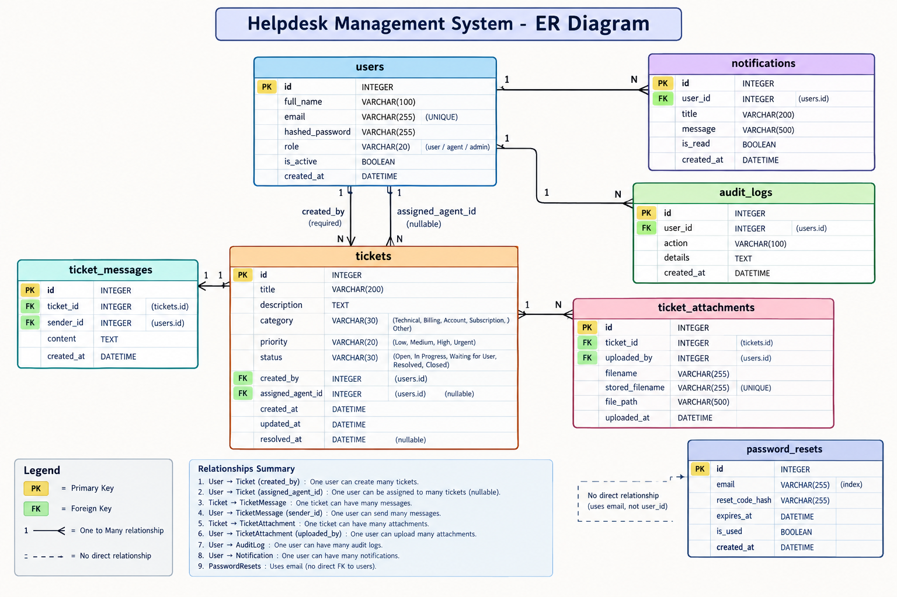

# Helpdesk Management System

## 1. Project Overview

The Helpdesk Management System is a web-based application designed to help users report issues and allow support staff to manage and resolve them. It provides a backend API built with FastAPI, a web frontend, and an SQLite database.

The system supports user authentication, ticket management, ticket assignment, status updates, ticket messages, file attachments, and role-based access control.

## 2. Technologies Used

- Python
- FastAPI
- SQLAlchemy
- SQLite
- HTML, CSS, and JavaScript
- JWT authentication
- Pytest
- Docker
- Docker Compose

## 3. Project Structure

```text
helpdesk_project/
├── app/
│   ├── dependencies/
│   ├── models/
│   ├── routers/
│   ├── schemas/
│   ├── services/
│   ├── utils/
│   └── database.py
├── frontend/
├── tests/
│   └── test_main.py
├── uploads/
├── main.py
├── requirements.txt
├── Dockerfile
├── docker-compose.yml
├── .dockerignore
├── helpdesk.db
└── README.md
```

## 4. Features

- User login and authentication
- Role-based access control
- Ticket creation and listing
- Ticket assignment to support agents
- Ticket priority and status management
- Ticket filtering, searching, pagination, and sorting
- Ticket conversations and messages
- File attachment upload and download
- Audit log access for administrators
- Automated tests using Pytest
- Docker-based API deployment

## 5. Requirements

For local development without Docker, install Python 3.13 or a compatible version.

For containerized execution, install Docker Desktop with Docker Compose.

## 6. Run the Project Locally

Open a terminal in the project root.

### Create and activate a virtual environment

On Windows PowerShell:

```powershell
python -m venv venv
.\venv\Scripts\Activate.ps1
```

### Install dependencies

```powershell
python -m pip install -r requirements.txt
```

### Configure the JWT secret

For local development, set a development secret in PowerShell:

```powershell
$env:JWT_SECRET_KEY = "replace-with-a-long-random-development-secret"
```

### Start the API

```powershell
python -m uvicorn main:app --reload
```

The API should be available at:

http://127.0.0.1:8000

Interactive API documentation:

http://127.0.0.1:8000/docs

## 7. Run with Docker

Make sure Docker Desktop is running.

From the project root, build the image:

```powershell
docker compose build
```

Start the application:

```powershell
docker compose up -d
```

Check container status:

```powershell
docker compose ps
```

View application logs:

```powershell
docker compose logs --tail 50 helpdesk
```

Stop the container:

```powershell
docker compose down
```

The Compose configuration maps port 8000 to the host and mounts the SQLite database and uploads directory so application data can persist outside the container.

The current Compose configuration uses SQLite and a single API container. It does not, by itself, provide a separate PostgreSQL database, Redis service, or background worker.

## 8. Frontend

The frontend files are stored in the `frontend` directory.

To serve the frontend locally, open a second terminal:

```powershell
cd frontend
python -m http.server 5500
```

Then open:

http://127.0.0.1:5500/

Keep the terminal running while using this local frontend server.

## 9. Running Automated Tests

Install the project dependencies, including the testing packages listed in `requirements.txt`.

Set the JWT secret in the terminal:

```powershell
$env:JWT_SECRET_KEY = "replace-with-a-long-random-development-secret"
```

Run the test suite:

```powershell
python -m pytest tests/test_main.py -v
```

The existing tests cover the home endpoint, unauthenticated ticket access, and role-based access to audit logs.

## 10. Important API Endpoints

The exact request fields and authentication requirements are documented in Swagger UI.

| Method | Endpoint | Purpose |
|---|---|---|
| GET | `/` | Check API availability |
| POST | `/api/auth/login` | Authenticate a user |
| GET | `/api/auth/me` | Retrieve the authenticated user's information |
| GET | `/api/tickets/` | List tickets |
| GET | `/docs` | Open interactive API documentation |

Additional ticket, message, attachment, and administrative endpoints are available in the API documentation.

## 11. Security Notes

- JWT authentication protects relevant API endpoints.
- Access to administrative functionality is restricted by role.
- Configure a strong, unique JWT secret for each deployment.
- Do not commit production secrets, passwords, or private environment files to a public repository.
- Use HTTPS and appropriate production security settings before exposing the application publicly.

## 12. Future Improvements

Possible improvements include expanding automated test coverage, adding a production database such as PostgreSQL, introducing Redis and background workers if required, and adding further monitoring and deployment configuration.
## Entity Relationship Diagram (ERD)

The following diagram illustrates the database tables and their relationships in the Helpdesk Management System.

